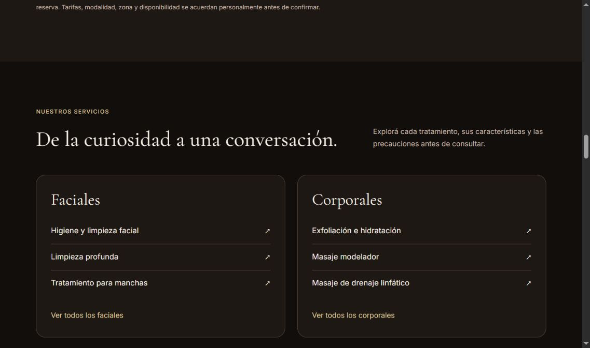
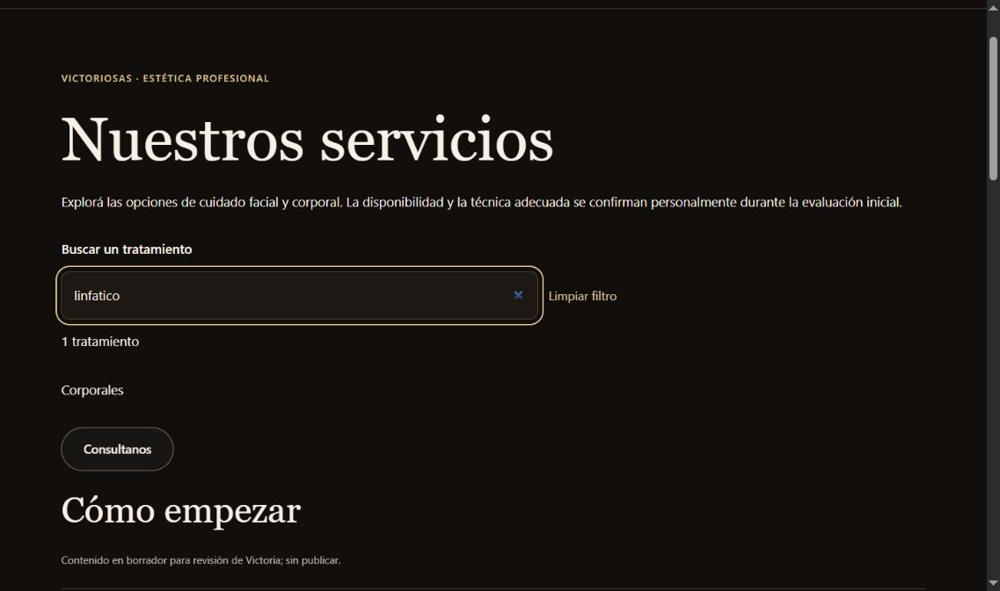
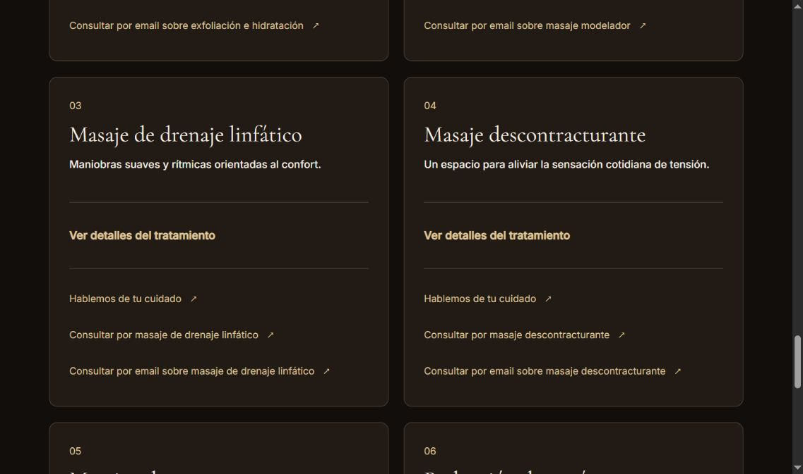

# Mejoras de descubrimiento · 31/10/2026

Referentes consultados: https://aliciarisotto.com/ (resultado de búsqueda; apertura completa agotó tiempo), https://esteticamanon.com/ (contenido completo), https://www.mareclinica.com/ (resultado de búsqueda; apertura completa agotó tiempo). Son negocios comparables por servicios; no hay métricas verificadas de ventas o conversión para ordenar su éxito. La cobertura periodística sobre trayectoria de Alicia Risotto no demuestra rendimiento de su web.

Manón organiza tratamientos en categorías faciales/corporales y ofrece acceso a consulta. Maré destaca valoración previa. Victoriosas ya tiene categorías, evaluación remota y contacto contextual; se evita duplicar esos recorridos o adoptar tratamientos médicos ajenos.

Implementación original: accesos desde portada a seis tratamientos existentes y a sus categorías completas; filtro local de los 17 servicios por nombre/subtítulo, sin distinguir tildes o mayúsculas, contador, limpieza y estado vacío. No envía términos a terceros ni añade analítica. No se copian textos, fotografías, testimonios o credenciales de competidores. Se conserva noir, catálogo, marca y contenido aprobado.

Recorrido revisado: 1) portada: jerarquía y contacto conservados; 2) accesos a tratamientos: enlaces a anclas existentes; 3) directorio: búsqueda y restablecimiento; 4) consulta: enlaces conservan servicio y evaluación remota, sin enviar mensajes. Capturas y pruebas del ciclo se registran junto a esta propuesta. No afirmar WCAG completa o mejoras de conversión sin medición.

La revisión local contiene borradores editoriales por configuración previa; no se habilita su publicación. Producción continúa bloqueada en Vercel. Rama independiente de PR155, sin merge ni despliegue.

Capturas de este ciclo: [portada y accesos](evidence/02-portada-tratamientos.jpg), [directorio filtrado](evidence/03-filtro-directorio.jpg). Se inspeccionaron las imágenes originales; se guardan sus bytes exactos. En ancho observado de 1137 px: sin desbordamiento horizontal y cero imágenes rotas. No se verificó un viewport móvil en esta captura ni cumplimiento WCAG completo.

La prueba de navegación real detectó que el ancla entre rutas no se desplazaba tras el montaje React. Se agregó desplazamiento al montar el directorio y al cambiar hash, limitado a sus propios elementos; no modifica historial ni abre detalles o envía consultas por su cuenta.

Validacion final: 382/382, tipos y ambos builds aprobados; directorio 3/3 y HTML/secret-scan aprobados. El ancla final queda a 110px de la parte superior en viewport de682px. Hubo un fallo intermedio del runner commerceMaintenance sin diagnostico concluyente; prueba aislada6/6 y repeticion completa aprobadas, sin modificar ese modulo.

